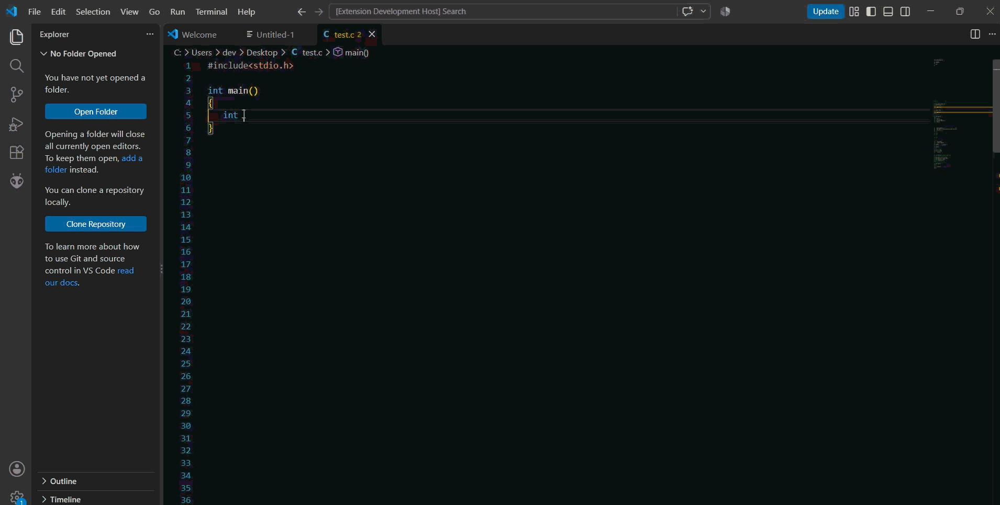

# Code Check — C Coding Standard Checker for VS Code

**Keep your C code clean, consistent, and maintainable.**

Code Check is a Visual Studio Code extension that helps C developers identify coding-standard violations directly in the editor. It helps developers write readable, consistent, and maintainable C code.

## ✨ Features

- 🔍 Checks C source code for coding-standard violations.
- ⚠️ Reports detected issues directly in the VS Code editor.
- 💡 Helps developers identify code-style problems.
- 🚀 Works directly inside Visual Studio Code.
- 🧹 Encourages clean and consistent C code.

## 🎬 Demo

See Code Check in action:

## 🚀 Getting Started

### Installation

1. Open Visual Studio Code.
2. Open the Extensions view using `Ctrl + Shift + X`.
3. Search for **Code Check**.
4. Install the extension.
5. Open a C source file (`.c`).

### Usage

1. Open a C project or a `.c` file in VS Code.
2. Write or modify your C code.
3. Let Code Check perform its implemented checking workflow.
4. Review detected coding-standard violations in the editor.
5. Open the **Problems** panel to inspect reported issues.

The exact checking trigger depends on the extension's implementation.

## 🧪 Example

Consider this C program with compact formatting:

### What can be improved?

- **Indentation:** Keep the function body consistently indented.
- **Spacing:** Separate statements to improve readability.
- **Structure:** Use line breaks to make the code easier to understand.
- **Maintainability:** Organize code so it is easier to modify.

> Note: This is an illustrative example. Whether these specific formatting issues are detected depends on the rules implemented in Code Check.

## 🖥️ Supported Language

Currently supported:

- **C** (`.c` files)

## ⚙️ Requirements

- [Visual Studio Code](https://code.visualstudio.com/)
- A C source file or C project

## 🔧 Extension Settings

Code Check does not currently require additional configuration.

Any future settings will be documented here.

## ⚠️ Known Issues

This extension is currently under development.

If you find a bug or an incorrectly reported violation, please open an issue in the project's repository.

When reporting an issue, include:

- The C code that reproduces the problem.
- The expected behavior.
- The actual behavior.
- Any relevant error messages.

## 🗺️ Future Improvements

Potential improvements include:

- Additional coding-standard rules.
- More descriptive diagnostic messages.
- Configurable coding-standard profiles.
- Improvements to code analysis.

These are possible future enhancements, not guaranteed features of the current release.

## 🤝 Contributing

Contributions, suggestions, and bug reports are welcome!

You can help improve Code Check by proposing new rules, reporting incorrect diagnostics, or contributing improvements to the extension.

## 📦 Release Notes

### 1.0.0

Initial release.

- Added C coding-standard checking.
- Added diagnostics for detected coding-standard violations.
- Integrated code checking into the VS Code workflow.

## 📄 License

See the [LICENSE](LICENSE) file for license information.

---

**Code Check — Write better C, one check at a time.**
